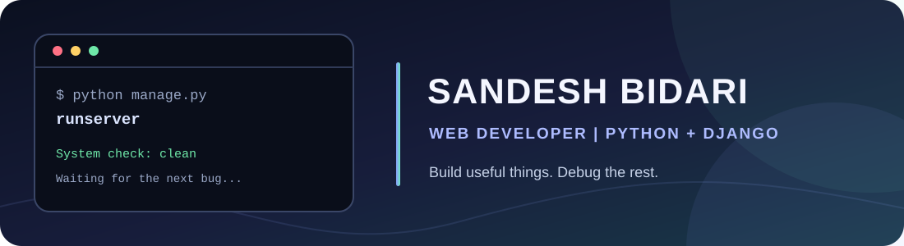
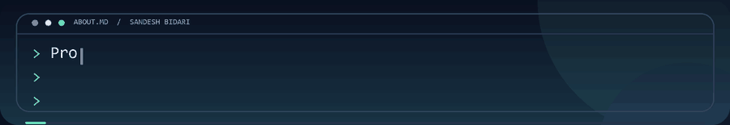
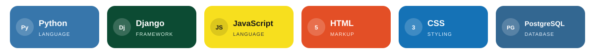

  
  

  
Web developer focused on Python, Django, and practical full-stack applications.

  

    <a href="https://bidari2sandesh.github.io/bidari2sandesh/">Open the interactive scroll page</a>
    &nbsp;|&nbsp;
    <a href="https://github.com/bidari2sandesh/my-portfolio">Featured project</a>
  

---

## Interactive scroll experience

The cinematic videos play in the background while the profile text types in as you scroll.

[Open the interactive page](https://bidari2sandesh.github.io/bidari2sandesh/)

## About me

I build Django-powered web applications that pair public-facing experiences with useful business workflows. My featured project brings together a photography portfolio, booking tools, media management, and role-based administration.

## Tech stack

  

## Featured project

### [Wedding Photography Business System](https://github.com/bidari2sandesh/my-portfolio)

A Django platform for a wedding photography business, with public portfolio pages, booking workflows, media and content management, and role-based administration.

**Stack:** Python | Django | JavaScript | PostgreSQL-ready configuration

## GitHub activity

[Repositories](https://github.com/bidari2sandesh?tab=repositories) | [Contributions](https://github.com/bidari2sandesh?tab=overview#contributions-calendar) | [Recent activity](https://github.com/bidari2sandesh?tab=overview)

  Thanks for stopping by. If you spot a bug, please leave a detailed issue so I can pretend it was part of the plan.

